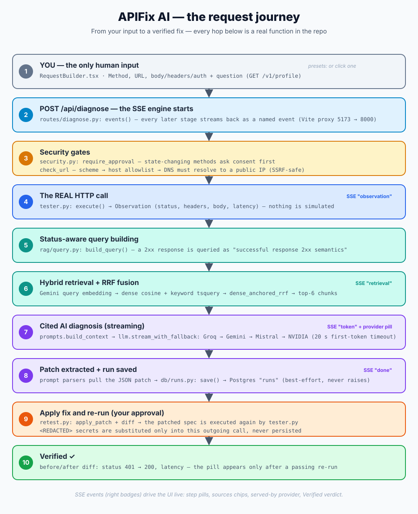

# APIFix AI

**Test APIs. Find evidence. Understand failures. Verify fixes.**

APIFix AI is a documentation-grounded API debugging assistant. It sends a real request, captures the observation, retrieves relevant documentation, streams a diagnosis with citations, suggests a patch, and retests only after approval.

> Full technical documentation lives in [`docs/README.md`](./docs/README.md) —
> architecture and connectivity, backend module-by-module, frontend state and
> contracts, knowledge base + retrieval + eval, and the security gates.

It is deliberately a vertical slice, not a production service.

## What works

- Mock API with deterministic 401/403/404/405/410/413/415/422/429/500/502/503/timeout/redirect/SSRF behavior.
- HTTPX tester with error classification, connect/total timeouts, and **no body ever attached to GET/HEAD** requests.
- Secret redaction (`<REDACTED>`) and an SSRF guard: scheme allowlist, exact-host allowlist, DNS-resolve + private-range block.
- **Dynamic SSRF allowlist** — hosts blocked by policy can be trusted from the UI with a validated "Allow host" button (`POST /api/allowed-hosts`); no restart needed.
- Live diagnosis with a **4-provider fallback chain** (Groq → Gemini → Mistral → NVIDIA, OpenAI-compatible), per-provider retries with backoff, and a first-token timeout so a stalled provider never hangs the run.
- Retrieval: Supabase pgvector (dense, 768-d) + PostgreSQL full-text keyword search, or a local Chroma + BM25 fallback; fused with dense-anchored weighted RRF.
- Upload-based RAG ingestion with `gemini-embedding-001` embeddings, persistent ChromaDB, BM25 keyword search, and hybrid retrieval.
- Seed knowledge base (`data/kb_chunks.jsonl`, **91 chunks**) auto-loaded into Chroma on first use, so uploads add to it instead of hiding it.
- **Run history in the database** — every diagnosis saved to Supabase Postgres (`runs` table) or local SQLite, rendered live in the sidebar.
- **Status-aware questioning** — a 2xx response queries "successful response semantics" instead of a stale failure question, so successful calls don't get polluted failure evidence.
- SSE diagnosis endpoint with citations and a JSON patch; the UI shows a "served by …" pill naming the provider that actually streamed each answer.
- Editable patch before retest, including a paste field per redacted token/header value (substituted only in the outgoing retest, never persisted).
- **Verify loop** — retest re-runs the patched request and shows a before/after diff; the "Verified ✓" pill appears only after a passing re-run.
- **Ask API tab**: grounded, streaming Q&A for API concepts, doubts, and fixes.
- **Question router with 7 real tools** — Ask first classifies the question (`app/ai/router.py`: fast rules → NVIDIA LLM for ambiguous → RAG default). API/docs questions go to RAG as always; tool questions hit live, keyless APIs or local computation: weather (Open-Meteo), currency conversion (Frankfurter/ECB), DNS lookup (dns.google), IP geolocation (ipwho.is), JWT/base64/URL decoder, unix-timestamp converter, and a world clock. Tool answers stream with a violet 🔧 chip naming the tool, and the raw tool facts survive even a total LLM outage.
- **Live health pills** in the header (runner, retrieval backend, database, provider chain) fetched from `GET /api/health` — no hardcoded stack claims in the UI.
- React UI for request, observation, diagnosis, citations, retest diff, and API Q&A.
- 50 evaluation request fixtures and an evidence map, with **4 Playwright e2e tests** for the browser app.

## How it works

<<<<<<< HEAD
=======


>>>>>>> feature/cloud-llm-parity
```
            ┌───────────────────────────────────────────────┐
            │            Browser (React + Vite)             │
            │   request builder · observation · diagnosis   │
            └──────────────────┬────────────────────────────┘
                               │ /api/* (vite proxy)
            ┌──────────────────▼────────────────────────────┐
            │               FastAPI backend                 │
            │  security → tester → RAG → LLM → retest       │
            └───┬───────────────┬───────────────┬───────────┘
                │               │               │
        ┌───────▼──────┐ ┌──────▼───────┐ ┌─────▼─────────────────┐
        │ Target API   │ │ Supabase     │ │ LLM providers         │
        │ under test   │ │ Postgres     │ │ Groq → Gemini →       │
        │ (httpx)      │ │ kb_chunks +  │ │ Mistral → NVIDIA      │
        │              │ │ runs         │ │ (first-serve chain)   │
        └──────────────┘ └──────────────┘ └───────────────────────┘
```

One run flows like this:

1. **Observe** — the real request is executed with HTTPX; the actual status, headers, body, latency and error classification are captured.
2. **Retrieve** — the question is phrased from the real status (2xx queries success semantics, failures include the status), then hybrid search (dense + keyword, dense-anchored weighted RRF) pulls the top 6 documentation chunks.
3. **Diagnose** — the LLM sees only the observation plus retrieved evidence and streams an answer where every claim cites a chunk ID; the UI shows which provider served it.
4. **Fix** — a JSON patch is extracted and shown editable; redacted secrets are filled in locally, only for the re-run.
5. **Verify** — the patched request is re-executed and diffed (status/latency before → after); the Verified pill appears only after a passing re-run. The run is saved to history either way.
<<<<<<< HEAD
=======

## Backend — the full process

Everything below is one request's journey through `backend/app`, with the real file and function at each step.

### Stage 1 — Reception and security (`core/security.py`)

| Step | Function | What it does |
|---|---|---|
| Reception | `routes/diagnose.py: diagnose()` → `events()` | Opens the SSE stream; every later stage is streamed back as a named event (`observation`, `retrieval`, `token`, `provider`, `done`) that the UI renders live |
| Approval gate | `require_approval()` | State-changing methods (POST/PUT/PATCH/DELETE) need explicit user consent (`approved: true`) or the stream sends `approval_required` and the UI asks |
| SSRF guard | `check_url()` | Three layers: scheme must be http(s) → hostname must be on an exact allowlist (env `ALLOWED_HOSTS` merged with app-managed `data/allowed_hosts.txt` on every check — `load_allowed_hosts()`) → every DNS-resolved IP must be public (loopback/private/link-local ranges refused). A blocked host can be trusted from the UI via `POST /api/allowed-hosts` (`routes/policy.py: add_host()`) |
| Secret redaction | `redact_headers()` / `redact_text()` | Secret-shaped values become `<REDACTED>` before the response body, LLM prompt, history, or patches ever see them |

### Stage 2 — Observation (`core/tester.py`)

- `execute(spec) -> Observation` — the **real** HTTP call through async HTTPX: `trust_env=False` (no silent proxy routing), connect/total timeouts, redirects not followed (status + Location surface instead), error classification into typed errors (`errors.py`: `PolicyError`, `DNSError`, timeout variants).
- **GET/HEAD/OPTIONS never receive a body** — a stale UI body cannot leak into a bodyless request.
- The `Observation` (status, selected headers, truncated body, latency) is the single truth object consumed by retrieval, the LLM, history, and the UI.

### Stage 3 — Evidence retrieval (`ai/rag/`)

| Step | File → function | What it does |
|---|---|---|
| Query building | `rag/query.py: build_query()` | Status-aware: a 2xx response is queried as "successful response 2xx semantics", ignoring stale failure-phrased questions |
| Embedding | `rag/embedding.py: embed_prompt()` | Google `gemini-embedding-001`, 768-dim, batched, RETRIEVAL_QUERY task type |
| Search | `rag/supabase_store.py: retrieve()` (or `rag/vector_store.py` local) | Dense cosine in **pgvector** + PostgreSQL full-text keyword search with an **OR lexeme tsquery**; fallback = local **Chroma + BM25**. Version guard (`rag/retriever.py: detect_version()`) flags `v3` requests against `v2` docs |
| Fusion | `rag/fusion.py: dense_anchored_rrf()` | `score = Σ weight/(60+rank)`; keyword weight 0.05, top-2 dense anchored in front. Measured on the 50-question eval set: hybrid Recall@5 = 1.000 |
| Orchestration | `rag/pipeline.py: retrieve_for_api()` | Embed → retrieve → score/filter/k=6; `ensure_seeded()` auto-loads `data/kb_chunks.jsonl` (91 chunks) into an empty store |

### Stage 4 — Diagnosis (`ai/llm.py`, `ai/prompts.py`)

- `prompts.py: build_context()` — the LLM sees **only** the redacted spec, the observation, and the retrieved chunks; it cannot invent what it was not shown.
- `llm.py: stream_with_fallback()` — `get_providers()` expands `PROVIDER_ORDER=groq,gemini,mistral,nvidia` (comma-separated keys/models rotate). Attempts are **first-serve**: retryable failures (429/5xx/timeout) retry the same provider up to `LLM_MAX_ATTEMPTS_PER_PROVIDER` with exponential backoff + jitter, then rotate; auth errors skip immediately; every provider change streams `provider_fallback` + `provider` SSE events.
- Token buffer → `prompts.py` citation/patch parsers → the JSON patch block shown as "SUGGESTED FIX".

### Stage 5 — Persistence (`db/runs.py`)

- `save()` — every run to the Supabase Postgres `runs` table (`_save_supabase()`) or local SQLite (`_save_sqlite()`), chosen by `DATABASE_URL`. Best-effort: a history failure **never** breaks the diagnosis stream. `list_runs()` feeds the sidebar.

### Stage 6 — Verification (`core/retest.py`)

- `apply_patch()` swaps patched fields into a fresh spec; `<REDACTED>` values are substituted **only into this outgoing retest call**, never persisted.
- `diff(before, after)` re-executes via `tester.py` and returns status/latency before → after plus a pass/fail verdict — the "Verified ✓" pill needs a passing re-run.

### The rest of the `/api` surface

| Route | Endpoint(s) | Process |
|---|---|---|
| `test.py` | `POST /api/test` | Bare observation without AI |
| `ask.py` | `POST /api/ask` | Question router first (`app/ai/router.py`): tool intents → real tool call (`app/ai/tools.py`, 7 tools) → `TOOL_SYSTEM_PROMPT` narration with `tool`/`tool_result` SSE events; everything else → same gates → same retrieval → `build_ask_context()` → fallback stream with SOURCES chips |
| `runs.py` | `GET /api/runs` | Recent history for the sidebar |
| `health.py` | `GET /api/health` | Real stack facts (runner, retrieval backend, database, provider chain) for the header pills |
| `policy.py` | `GET/POST /api/allowed-hosts` | Validated allowlist self-service (`hostname[:port]` syntax, 422 on garbage) |
| `upload.py` / `ingest.py` | upload → ingest → delete; `GET /api/kb/stats` | Extension/size-validated uploads → parse (`scripts/parse_openapi.py`) → chunk by tokens (`scripts/chunk_text.py`) → Gemini-embed → pgvector upsert, attributed by source file so deleting a file deletes exactly its chunks |
| `search.py` | `POST /api/search` | Direct KB search across dense/keyword/hybrid modes |

## Frontend — the full process

React 19 + TypeScript + Vite + Tailwind. All server access flows through `/api/*` proxied to :8000 (`vite.config.ts`).

### State hub (`App.tsx`)

One owner for every top-level state: `spec` (the request), `observation`, streamed diagnosis text, `citations`, `patch`/suggested fix, `providerLabel` + `fallbacks` (who served the answer), `retestResult`, `recentRuns`, uploaded files, KB stats, presets. The run function maps each SSE event type explicitly to states.

### The SSE reader (`lib/sse.ts`)

`streamSSE()` posts JSON, asserts 200, and decodes `event:/data:` frames with typed callbacks; `streamDiagnosis()` / `streamAsk()` wrap it. Event handling:

| SSE event | What the UI does |
|---|---|
| `observation` | `ResponseViewer` renders the live status card (status badge, latency, body preview) |
| `retrieval` | Sources chips appear (KB-xxx citation IDs with links) |
| `token` | Diagnosis text streams into `DiagnosisViewer` |
| `provider` / `provider_fallback` | "served by `<provider label>`" pill + failover tooltip |
| `done` | SUGGESTED FIX block + patch edit; status → done; runs list refreshes |
| `approval_required` | Consent prompt before state-changing calls |
| `error` | `blocked_by_policy` → **"Allow host"** button (`ResponseViewer`); `no_providers_configured` → clear message; test still shows the observation |

### Components and their processes

| Component | Process |
|---|---|
| `Header.tsx` | Tabs + **status pills** fetched live from `/api/health` (runner, retrieval backend, provider chain) — degrades to neutral labels if the backend is down |
| `Sidebar.tsx` | Collections (bundled KB chunk count from `/api/kb/stats`, imported files from `/api/files`), **Recent Tests** from `/api/runs` with relative timestamps, OpenAPI import with "Uploading & indexing..." state |
| `RequestBuilder.tsx` | Method/URL/body/headers/auth/params; auto-strips a pasted `GET https://…` verb; empty question with a **status-aware placeholder** |
| `ResponseViewer.tsx` | Real observation card; detects SSRF-blocked hosts and offers the validated "Allow host" button; honest footer labels sample vs live data |
| `DiagnosisViewer.tsx` | Step pills (Tested → Retrieved → Diagnosed → Verify), status-aware heading ("What Went Wrong" for failures, "What Happened" for 2xx), streaming text, SOURCES chips, editable patch, per-`<REDACTED>` secret inputs — **Apply stays disabled while any redaction remains**, then calls `/api/retest` and shows the before/after verdict |
| `AskPanel.tsx` | Chat for API concepts: same retrieval, streamed answers, source chips, last-4-message context, "New chat" reset |

### Import process (frontend side)

Upload → `/api/upload` → `/api/ingest` → parse the spec JSON → up to **8 endpoint presets** (base URL from `servers[0]`, path params filled with "1") → first preset selected → KB stats refreshed. Imported endpoints then behave like bundled ones, citable in diagnoses and Ask.
>>>>>>> feature/cloud-llm-parity

## Retrieval evaluation

Measured on the `dev` split with a temporary Chroma collection seeded from
`data/kb_chunks.jsonl` using `gemini-embedding-001` (768 dimensions):

| Mode | Recall@5 | MRR | Scored cases |
|---|---:|---:|---:|
| Dense | 0.971 | 0.623 | 35 |
| Keyword | 0.614 | 0.375 | 35 |
| Hybrid | 1.000 | 0.629 | 35 |

The hybrid row uses dense-anchored weighted RRF: the best two dense results
keep their order, then keyword contributes a small rank bonus (`RRF_KEYWORD_WEIGHT=0.05`)
so it can rescue a relevant chunk that dense ranked just outside the top 5.
Tuning was done on the dev split and confirmed on heldout (dense 1.000/0.564,
hybrid 1.000/0.576), so hybrid now improves both recall and ranking quality
instead of trading MRR for recall.

The same dense and hybrid scores were verified against a live Supabase pgvector
store (91 chunks). Supabase keyword search uses PostgreSQL full-text search,
which ANDs query terms by default and returns nothing for a natural-language
question; the backend builds an OR `tsquery` from the question's lexemes
instead. Its standalone keyword Recall@5 is lower than local BM25 (0.471 dev /
0.545 heldout), but hybrid still reaches 1.000 because it keeps a wider keyword
candidate pool and anchors the best dense results.

The corpus is small and the scores are directional. Run `python eval/run_eval.py
--split dev` or `--split heldout`. The seed corpus is loaded into Chroma on
first use, so no manual ingestion is required. Questions with no expected
evidence are reported as abstentions and excluded from Recall@5/MRR averages.

### Not yet verified here

- Live LLM diagnosis and the provider chain are verified locally with real keys; quota fallback still depends on each provider's current free-tier limits at any given time.
- Network-dependent e2e cases (DNS/TLS fixtures) are skipped offline.

## What is not finished

- The evaluation runner currently scores **retrieval only**; diagnosis correctness, citation accuracy, unsupported claims, and retest scoring are the next step.
- The seed knowledge base has 91 starter chunks. Replace them with real source excerpts and add the rest of the 60–100 chunk set.
- `eval/evidence_map.json` is a starting map; refine it after ingestion.
- No production auth, multi-tenancy, or deployment hardening.

## Repository layout

```text
backend/app/main.py  FastAPI app: lifespan startup, CORS, router wiring
backend/app/core/    settings, domain models, errors, security, tester, retest
backend/app/db/      run history dispatcher: Supabase Postgres or local SQLite
backend/app/ai/      LLM fallback chain, prompts, prompt context builders
backend/app/ai/rag/  RAG loading, chunking, embeddings, ChromaDB, and pipeline
backend/app/routes/  one APIRouter per feature (health, test, diagnose, ask, ...)
backend/app/utils/   shared helpers (UUID generation)
backend/uploads/     local uploaded documents (gitignored)
backend/data/chroma/ persistent ChromaDB files (gitignored)
backend/mock_api/    deterministic local API
backend/scripts/     provider check, ingestion, local index, scenario runner
backend/tests/       unit, route, retrieval, security, and seed tests
data/                knowledge base + datasets
eval/                case requests, evidence map, evaluation runner
frontend/            React + Vite + Tailwind UI + Playwright e2e
docs/                technical documentation set (start at docs/README.md)
```

## Quick start

### 1. Python environment

```bash
python3 -m venv .venv
source .venv/bin/activate
pip install -r backend/requirements.txt
cp .env.example .env
```

If `python3 -m venv` fails with `ensurepip is not available`, install the
`python3-venv` (or `python3.12-venv`) package first.

### 2. Build the local retrieval index

<<<<<<< HEAD
Embeddings use Google's `gemini-embedding-001` (768 dimensions), the same model
family as `cloud_llm`, so `GEMINI_API_KEY` must be set in `.env` (see step 6)
=======
Embeddings use Google's `gemini-embedding-001` (768 dimensions), so
`GEMINI_API_KEY` must be set in `.env` (see step 6)
>>>>>>> feature/cloud-llm-parity
before building the index. This works without Supabase:

```bash
python backend/scripts/build_local_index.py
```

The script reads `data/kb_chunks.jsonl` (the canonical 91-chunk knowledge base —
the same file the backend auto-seeds from), calls the Gemini embedding API, and
writes `data/kb_embeddings.npy` and `data/kb_meta.json`. Rebuild the index
whenever `EMBED_MODEL` or `EMBED_DIM` changes.

### 2a. Upload and index documents with ChromaDB

The upload/ingest/search endpoints are available at both `/api/...` and their
root paths. Allowed file types are PDF, DOCX, XLSX, PPTX, HTML, XML, CSV,
TSV, JSON, YAML, JSONL, Markdown, and text;
uploads are limited by `MAX_UPLOAD_MB`.

```bash
curl -F 'files=@data/kb_chunks.jsonl' http://127.0.0.1:8000/api/upload
curl -X POST http://127.0.0.1:8000/api/ingest
curl -X POST http://127.0.0.1:8000/api/search \
  -H 'Content-Type: application/json' \
  -d '{"query":"What does HTTP 401 mean?","mode":"hybrid","k":5}'
```

Configure `UPLOAD_DIR`, `CHROMA_DIR`, `EMBED_MODEL`, `EMBED_DIM`,
`CHUNK_TOKENIZER_MODEL`, and `MAX_UPLOAD_MB` in `.env` to override the defaults.
Chroma collections are named per embedding model and dimension, so switching
models creates a separate index instead of mixing incompatible vectors.

On the first retrieval, search, or KB-stats call, the backend loads
`data/kb_chunks.jsonl` into Chroma if the collection is empty. Uploaded
documents are added alongside the seed corpus. Set `SEED_KB=false` to start
with an empty knowledge base, or `SEED_KB_FILE=<path>` to use a different seed
file.

### 2b. Batch ingestion

<<<<<<< HEAD
Ingestion follows the same shape as `cloud_llm`: files are processed in batches
=======
Ingestion is bounded and throttled: files are processed in batches
>>>>>>> feature/cloud-llm-parity
of `BATCH_FILE_SIZE` (default 10), up to `BATCH_MAX_CONCURRENCY` (default 4)
files are prepared at once, duplicate files in the same batch are skipped, and
chunks are embedded in requests capped at `EMBED_MAX_CHUNKS_PER_REQUEST`
(default 64) and `EMBED_MAX_TOKENS_PER_REQUEST` (default 8,000). Gemini requests
are throttled to `EMBED_REQUESTS_PER_MINUTE` (default 60) and
`EMBED_TOKENS_PER_MINUTE` (default 100,000), with retries controlled by
`EMBED_MAX_RETRIES`, `EMBED_RETRY_BASE_DELAY_S`, and `EMBED_RETRY_MAX_DELAY_S`.

`POST /api/ingest` returns both totals and per-file statuses
(`completed`, `skipped`, `empty`, or `failed`) so one bad file does not discard
the rest of the batch:

```json
{
  "chunks_added": 91,
  "sources": ["kb_chunks.jsonl"],
  "files": [
    {"file": "kb_chunks.jsonl", "status": "completed", "chunks_added": 91, "message": "..."}
  ]
}
```

### 3. Run the mock API

From the repository root:

```bash
python run_mock.py
```

### 4. Run the backend

From the repository root:

```bash
python server.py
```

### 5. Run the frontend

```bash
cd frontend
npm install
npm run dev
```

Open `http://localhost:5173`.

### 6. Add provider keys

Edit `.env`:

```bash
GROQ_API_KEY=...
GROQ_MODEL=openai/gpt-oss-120b,qwen/qwen3.8-27b
GEMINI_API_KEY=...
GEMINI_MODEL=gemini-flash-latest,gemini-3.5-flash
MISTRAL_API_KEY=...
MISTRAL_MODEL=mistral-small-latest
NVIDIA_API_KEY=...
NVIDIA_MODEL=openai/gpt-oss-20b
PROVIDER_ORDER=groq,gemini,mistral,nvidia
```

`GEMINI_MODEL`, `GROQ_MODEL`, `MISTRAL_MODEL`, and `NVIDIA_MODEL` accept
comma-separated models and providers are streamed in `PROVIDER_ORDER` (empty
`NVIDIA_MODEL` disables a provider). NVIDIA speaks the OpenAI-compatible NIM
endpoint. A retryable failure
(429/quota, timeout, connection error, 5xx) is retried on the **same** model
and key up to `LLM_MAX_ATTEMPTS_PER_PROVIDER` times (default 3) with exponential
backoff and jitter; only then does the backend rotate to the next model or
provider. Authentication errors move on immediately. Timeouts come from
`LLM_FIRST_TOKEN_TIMEOUT_S` and `LLM_TIMEOUT_S`. Add `GEMINI_API_KEYS`,
`GROQ_API_KEYS`, or `MISTRAL_API_KEYS` (comma-separated) to rotate across
multiple keys too.

Verify them:

```bash
python backend/scripts/check_providers.py
```

If no provider is configured, `/api/diagnose` returns a clear `no_providers_configured` error. `/api/test` still works.

## Deploy frontend and backend

Deploy the FastAPI backend as a Render Web Service and the Vite frontend as a
Vercel project. Keep API keys and database credentials in Render environment
variables; the frontend only needs the public backend URL.

### 1. Prepare persistent data storage

For hosted deployments, use Supabase pgvector rather than local Chroma/SQLite,
which may be lost when a Render service restarts or redeploys:

1. Create a Supabase project and run [`backend/sql/schema.sql`](backend/sql/schema.sql)
   once in **SQL Editor**.
2. Copy the **Session pooler** connection string from **Project Settings →
   Database**. Use it as `DATABASE_URL` in Render; keep it private.

### 2. Deploy the backend to Render

Create a **New Web Service**, connect this GitHub repository, and select the
branch containing the deployment code. Leave **Root Directory** empty so
commands run from the repository root. Choose **Python 3** and configure:

| Render setting | Value |
|---|---|
| Build Command | `pip install -r backend/requirements.txt` |
| Start Command | `PYTHONPATH=backend uvicorn app.main:app --host 0.0.0.0 --port $PORT` |
| Health Check Path | `/api/health` |

Memory note: startup imports ~120 MB RSS (chunking loads only the MiniLM
**tokenizer**, not the torch model), and `chromadb` is not installed at all in
production (Supabase pgvector never imports it — see
`backend/requirements-local.txt`), so builds skip torch and the ~10 heavy
chromadb transitive dependencies. On older copies that installed
sentence-transformers, Render OOM-killed the process (exit 137) before the
port opened.

Add these environment variables in Render (enter real secrets in the dashboard,
not in source control):

```text
RETRIEVAL_BACKEND=supabase
DATABASE_URL=<Supabase session-pooler connection string>
GEMINI_API_KEY=<key used for embeddings>
GROQ_API_KEY=<optional generation provider key>
MISTRAL_API_KEY=<optional generation provider key>
NVIDIA_API_KEY=<optional generation provider key>
PROVIDER_ORDER=groq,gemini,mistral,nvidia
SEED_KB=true
FRONTEND_ORIGIN=https://<your-vercel-production-domain>
ALLOWED_HOSTS=<comma-separated API hosts you want to test>
```

At least one LLM provider key is needed for diagnosis and Q&A; `GEMINI_API_KEY`
is needed to embed the seed knowledge base and uploaded documents. `ALLOWED_HOSTS`
must list the exact external API hosts the app may send test requests to, without
`http://` or `https://`. After deployment, check
`https://<your-render-service>.onrender.com/api/health`.

### 3. Deploy the frontend to Vercel

Import the same GitHub repository as a Vercel project. Set **Root Directory**
to `frontend` and use the Vite defaults:

| Vercel setting | Value |
|---|---|
| Framework Preset | Vite |
| Build Command | `npm run build` |
| Output Directory | `dist` |
| Environment Variable | `VITE_API_BASE_URL=https://<your-render-service>.onrender.com` |

Set `VITE_API_BASE_URL` for **Production** (and Preview if needed), then deploy
or redeploy. Add the exact Vercel production URL to Render's `FRONTEND_ORIGIN`
and redeploy the backend if you change it. Multiple comma-separated frontend
origins are supported for testing a known Preview URL. Do not put provider keys
or `DATABASE_URL` in Vercel; `VITE_*` variables are included in browser code.

### 4. Verify the deployment

Open the Vercel site, check the header health pills, and run a test against a
host listed in `ALLOWED_HOSTS`. `/api/health` should return JSON from Render,
not a Vercel 404 or a CORS error. The first knowledge-base request may seed the
bundled documents and call Gemini embeddings.

## Demo request

In the UI:

- Method: `GET`
- URL: `http://localhost:8001/v1/profile`
- Headers: `Accept: application/json`
- Question: `Why does this request return 401?`

Expected: observation `401`, cited MDN 401 evidence, a patch that adds `Authorization: Bearer valid-user-token`, and a retest to `200`.

### Ask API assistant

Use the **Ask API** tab for general API questions. A question router decides
where each question goes: API/docs questions hit the same retriever for
grounded sources (and the same provider fallback keeps the answer streaming if
a model is rate-limited); live-data questions are answered by real tools
instead — try `weather in Chennai`, `convert 5000 inr to usd`, `check dns of
api.github.com`, `where is 8.8.8.8`, `time in Tokyo`, `what is 1730000000 in
date?`, or paste a JWT with "decode this JWT …". The chat shows a violet
🔧 chip naming the tool while it runs. Ask history is persisted like diagnosis
runs (`ask_turns` table, Supabase Postgres or SQLite fallback) — recent
questions reappear in the "Ask history" panel and can be reopened after a
reload via `GET /api/ask/history`.

Token usage is deliberately capped: Ask sends only the **last 4 messages** as
conversation context, retrieves **4 evidence chunks**, and asks the model to keep
answers under **200 words**. Use **New chat** to start fresh and avoid sending
old history.

```bash
curl -N -X POST http://127.0.0.1:8000/api/ask \
  -H 'Content-Type: application/json' \
  -d '{"question":"What is idempotency and why do POST retries create duplicates?","history":[]}'
```


## Supabase pgvector

The app uses Supabase only when `RETRIEVAL_BACKEND=supabase` and
`DATABASE_URL` is set to a real (non-placeholder) value. Otherwise it uses the
local Chroma index. Both stores implement the same interface, so `/api/search`,
`/api/diagnose`, `/api/ask`, uploads, deletes, and `eval/run_eval.py` work
against either one.

1. Create a Supabase project and open **SQL Editor**.
2. Run [`backend/sql/schema.sql`](backend/sql/schema.sql) once. It enables the
   `vector` extension and creates `kb_chunks` with HNSW and full-text indexes.
3. Copy the **Session pooler** connection string from **Project Settings →
   Database**. Replace `[YOUR-PASSWORD]` and URL-encode special characters
   (`@` → `%40`, `#` → `%23`, `:` → `%3A`). Keep `?sslmode=require`.
4. Set these in `.env`:

   ```bash
   DATABASE_URL=postgresql://postgres.<ref>:<password>@aws-0-<region>.pooler.supabase.com:5432/postgres?sslmode=require
   RETRIEVAL_BACKEND=supabase
   ```

   `DATABASE_URL` is the only Supabase setting the backend needs; the pgvector
   retriever connects to it directly. If the value still contains the
   `.env.example` placeholders (`<ref>`, `<password>`, `<region>`), the app
   treats Supabase as unconfigured and stays on the local Chroma store instead
   of attempting a connection.
5. Install the Python deps (already listed in `backend/requirements.txt`):

   ```bash
   .venv/bin/pip install -r backend/requirements.txt
   ```

6. Load the 91-chunk seed corpus:

   ```bash
   python backend/scripts/ingest.py
   ```

   Alternatively, start the API with `SEED_KB=true` and the first search,
   diagnosis, or KB-stats call loads `data/kb_chunks.jsonl` into Supabase
   automatically.

7. Verify the connection and retrieval:

   ```bash
   python backend/scripts/check_supabase.py
   ```

   It prints the store type, chunk count, and top hybrid hits. Restart the API
   after changing `.env`, then try `/api/search` or the Ask API tab.

If the database is unreachable, the app logs a warning and falls back to
Chroma. Set `RETRIEVAL_BACKEND=local` to make that explicit. Local mode needs
the optional Chroma dependency, which production images skip to stay small:

```bash
pip install -r backend/requirements-local.txt
```

The schema is
`vector(768)` because `gemini-embedding-001` produces 768-dimensional
embeddings; if you change `EMBED_MODEL`/`EMBED_DIM`, update the column dimension
and re-ingest. If `kb_chunks` was created for the old 384-dimensional MiniLM
vectors, run [`backend/sql/migrate_embedding_384_to_768.sql`](backend/sql/migrate_embedding_384_to_768.sql)
first. Uploads written while one backend is active are not copied to the other,
so re-upload or run `ingest.py` after switching stores.

## Tests

From the repository root:

```bash
PYTHONPATH=backend pytest backend/tests -q
```

80 tests across unit, route, retrieval, security, and seed coverage. The suite
includes `test_api_httpx.py`, which drives
the real FastAPI app through `httpx.ASGITransport` and starts the mock API on a
random port to exercise `/api/test`, `/api/retest`, upload → ingest → search →
delete, and the `/api/diagnose` and `/api/ask` SSE streams.

Mock API scenario smoke test (start `python run_mock.py` first):

```bash
python backend/scripts/run_scenarios.py
# add --network to include the external API checks
```

`--network` calls `postman-echo.com`, `petstore3.swagger.io`, and
`jsonplaceholder.typicode.com`. Those hosts must be in `ALLOWED_HOSTS`
(`.env.example` already lists them). Bare hosts are allowlisted for the
scheme's default port only, e.g. `postman-echo.com` permits HTTPS port 443 but
not `:8443`.

Browser tests use Playwright with route interception, so they do not need the
backend or an LLM key:

```bash
cd frontend
npm install
npx playwright install chromium
npm run test:e2e
```

Playwright requires Node 20 or newer. If your system Node is older, point
`PATH` at a Node 20 install first, for example:

```bash
PATH=/path/to/node20/bin:$PATH npm run test:e2e
```

## Evaluation

The runner auto-loads the seed corpus into Chroma when the collection is empty:

```bash
python eval/run_eval.py --split dev
python eval/run_eval.py --split heldout
```

The runner reads `eval/eval_questions.jsonl` and prints Recall@5 and MRR for
dense, keyword, and hybrid retrieval.

---
