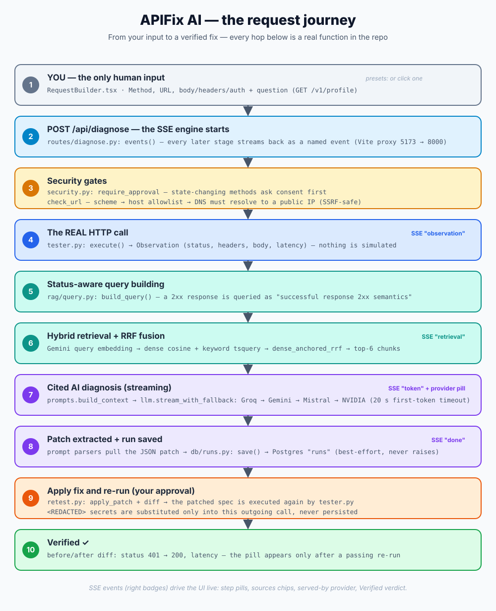
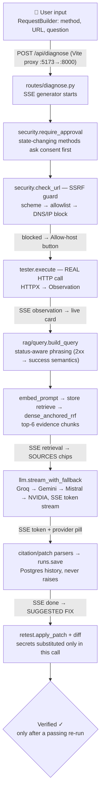

# Workflow — where input enters and how it is processed

This document traces every input the system accepts through every hop it
takes, with the exact file and function at each step. Companion docs:
[`architecture.md`](./architecture.md) (components and connectivity) and
[`backend.md`](./backend.md) (module list).

## 1. Input entry points

| # | Input | Entered in the UI | Endpoint reached |
|---|---|---|---|
| 1 | API request (method, URL, body/headers/auth) + question | `RequestBuilder.tsx`, or a preset click in `Sidebar.tsx` | `POST /api/diagnose` |
| 2 | Chat question | `AskPanel.tsx` | `POST /api/ask` |
| 3 | OpenAPI file (JSON/YAML) | `Sidebar.tsx` → "Import OpenAPI file" | `POST /api/upload` → `POST /api/ingest` |
| 4 | A host to trust | `ResponseViewer.tsx` → "Allow host" button | `POST /api/allowed-hosts` |

One-sentence summary of the main flow:

> **Input enters in RequestBuilder, is guarded by `security.py`, executed by
> `tester.py`, phrased by `rag/query.py`, evidenced by the RAG pipeline,
> narrated by the provider chain, saved by `runs.py`, and verified by
> `retest.py`.**

## 2. Flow A — Run test + live diagnosis (the primary loop)





Text version of the same flow, hop by hop:

```
YOU (RequestBuilder: GET http://localhost:8001/v1/profile)
 │
 ①  App.tsx.runDiagnose → streamDiagnosis() [lib/sse.ts]
      POST /api/diagnose  (Vite proxy 5173 → 8000)
 │
 ②  routes/diagnose.py: diagnose() → events() SSE generator starts
 │
 ③  core/security.py: require_approval(spec)
      POST/PUT/PATCH/DELETE without consent → approval_required event → UI asks
 │
 ④  core/security.py: check_url()
      scheme ok? host allowlisted? DNS → public IP? else blocked_by_policy
      (+ the UI offers a validated "Allow host" button)
 │
 ⑤  core/tester.py: execute(spec)
      REAL HTTP request via HTTPX → Observation (status, headers, body, latency)
      └─▶ SSE "observation" ──▶ ResponseViewer renders the live status card
 │
 ⑥  ai/rag/query.py: build_query(spec, obs)
      status-aware phrasing: a 2xx response is queried as
      "successful response 2xx semantics" — stale failure questions ignored
 │
 ⑦  ai/rag/embedding.py: embed_prompt
      → ai/rag/supabase_store.py retrieve()   (dense cosine + keyword tsquery)
      → ai/rag/fusion.py: dense_anchored_rrf  (top-2 dense anchored, fused order)
      └─▶ SSE "retrieval" (top-6 chunks) ──▶ SOURCES chips light up
 │
 ⑧  ai/prompts.py: build_context  →  ai/llm.py: stream_with_fallback
      Provider chain first-serve (Groq → Gemini → Mistral → NVIDIA),
      20 s first-token timeout, each provider change is an SSE event
      └─▶ SSE tokens ──▶ DiagnosisViewer streams + "served by" pill
 │
 ⑨  prompts.py citation/patch parsers  ──▶ SSE "done" (diagnosis + patch)
      └─▶ db/runs.py: save()   (Postgres `runs` table; never raises —
           a history failure cannot kill the stream)
 │
 ⑩  user pastes real secrets into the redacted fields → Apply fix and re-run
      └─▶ POST /api/retest  →  core/retest.py: apply_patch + diff
           → core/tester.py: execute (patched spec)
           └─▶ before/after diff (e.g. 401 → 200) ──▶ "Verified ✓" pill
``````

### Hop table (Flow A)

| Hop | File → function | Input | Output | UI shows |
|---|---|---|---|---|
| ① | `App.tsx` → `lib/sse.ts:streamDiagnosis` | editable spec | JSON POST | request card |
| ② | `routes/diagnose.py:events()` | spec | SSE stream opens | step pills wait |
| ③ | `security.require_approval` | spec | approve/ask | consent dialog |
| ④ | `security.check_url` | URL | pass / `blocked_by_policy` | status or Allow-host hint |
| ⑤ | `tester.execute` | spec | `Observation` | SSE `observation` → live card |
| ⑥ | `rag.query.build_query` | spec + obs | retrieval query | — |
| ⑦ | `embedding` → store → `fusion` | query | top-6 chunks | SSE `retrieval` → SOURCES |
| ⑧ | `prompts.build_context` → `llm.stream_with_fallback` | chunks + obs | token stream | SSE `token`/`provider` |
| ⑨ | citation/patch parsers → `runs.save` | token buffer | patch + run row | SSE `done` → SUGGESTED FIX |
| ⑩ | `retest.apply_patch` + `diff` → `tester.execute` | patched spec | verdict | Verified ✓ pill |

## 3. Flow B — Ask API (chat)

```
YOU (AskPanel) → POST /api/ask {question, last-4 messages}
  → routes/ask.py: same security gates
  → retrieval (same store, mode-aware) → evidence chunks
  → build_ask_context → stream with fallback
  → answer streams with SOURCES chips linking to chunk provenance
```

Token discipline: last **4** messages, **4** evidence chunks, ~**200-word**
answer cap — "New chat" clears history.

## 4. Flow C — Import an OpenAPI spec (upload → ingest → presets)

```
Browser file input → POST /api/upload
  1. routes/upload.py validates extension/size, sanitizes name
     → data/uploads/<name>-<hash>.<ext>
  2. POST /api/ingest → parse (scripts/parse_openapi.py)
     → chunk_by_tokens (scripts/chunk_text.py)
     → embed (embedding.py, gemini-embedding-001, 768-d, batched)
     → insert into kb_chunks (SupabaseStore.insert, source_file attributed)
  3. GET /api/files shows the file; POST /api/kb/stats refreshes the count
  4. Browser parses the spec JSON → up to 8 endpoint presets
     (servers[0] as base URL, path params filled with "1")
  5. Deleting the file (DELETE /api/files/{name}) removes exactly its chunks
     (SupabaseStore.delete_source) — attribution makes cleanup precise
```

After ingest, imported endpoints are first-class KB citizens: diagnoses and
Ask answers can cite their chunks like any bundled chunk.

## 5. Flow D — Allowlist self-service (SSRF recovery)

```
check_url blocks host X → blocked_by_policy observation
  → ResponseViewer detects the host (blockedHost()) → "Allow X" button
  → POST /api/allowed-hosts (strict hostname[:port] syntax, 422 on junk)
  → routes/policy.py:add_host appends to data/allowed_hosts.txt
  → future check_url calls merge env + file lists (load_allowed_hosts)
  → user re-runs the test; IP-range checks STILL apply (internal targets
    stay unreachable — trusting a host only allows name resolution)
```

No restart is required at any point in this flow.
Python
LLM
Prompt Engineering
OOPS
Types of LLM
LLM Models
Tokens, Tokenization, context window, Temperature
LLM Inference
Folder Structure
Networking 
Naming convention
Git, GitHub
Multimodal AI
HTTP, HTTPS, STATUS CODE
Prompt Engineering Types
FastApi
Rag
Data ingestion, Reterival, Generation
Chunk, vector DB, Semantic Search, vector search, keyword search
Rag weightage
Types of Rag
Chunking Types
Rag Workflow
## 6. Flow E — Run history (always side-effect, never blocking)

| Step | Where | Guarantee |
|---|---|---|
| Choose backend | `db/runs.py:uses_supabase()` | `DATABASE_URL` → Postgres; else SQLite `data/runs.sqlite3` |
| Save | `save()` after every diagnose | Best-effort: history failure cannot break the stream |
| List | `GET /api/runs` → `list_runs(limit=8)` | Newest first → sidebar Recent Tests, relative timestamps |

## 7. Failover flow (invisible until you watch)

```
stream_with_fallback (ai/llm.py)
  attempt provider 1 → stall/429/503/auth? → next attempt (same chain order)
  ... until one provider emits its first token
  every change streams: SSE "provider_fallback" {from, reason} + SSE "provider"
  ⇒ the UI's "served by" pill and its tooltip reflect WHO actually answered
```

## 8. Why Playwright is not in the architecture diagram

The architecture shows the **runtime system** — components that *serve the
user*: browser React app → FastAPI → {target API, Postgres, LLM providers}.

Playwright is a **development-time test instrument** in `frontend/e2e/` that
impersonates a browser to verify the React app (the 4 e2e tests). It runs only
when invoked (`npx playwright test e2e`) and is never part of a user's
request path — the same reason pytest (80 backend tests) is not in the
diagram: test tools *inspect* the system, they do not *ship* in it.

As a visual, place it outside the components with a dashed arrow:

```
Playwright (test-time only) ┄┄▶ Browser React app
```
